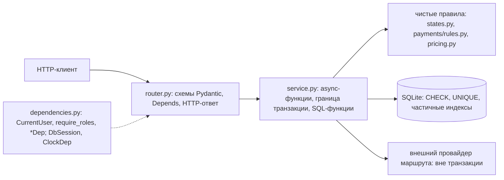
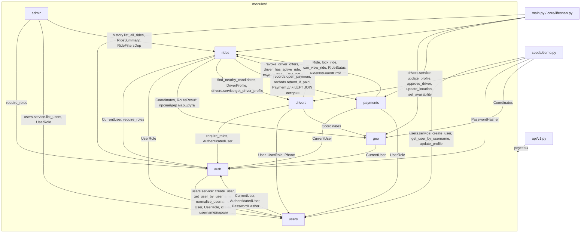
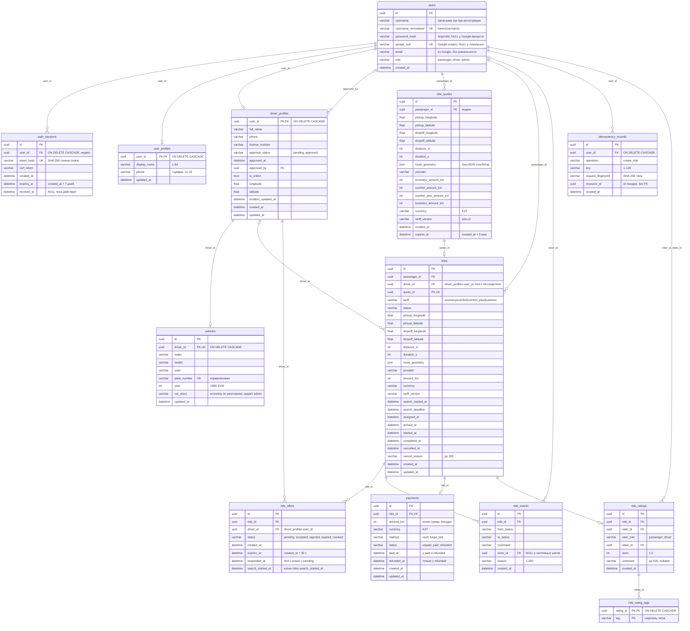
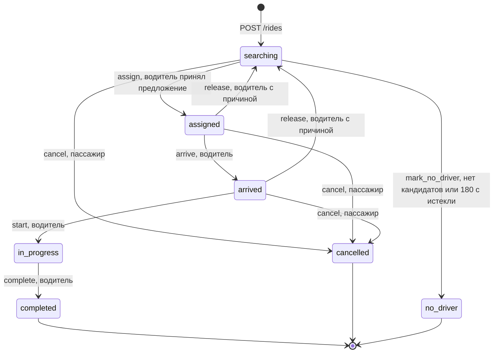
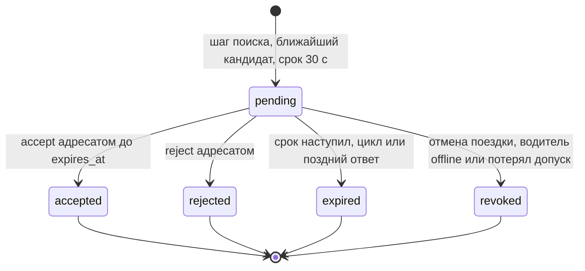

# Архитектура backend MVP

Как устроено приложение Mini Taxi Service: слои, транзакции, модули и их зависимости, схема данных, состояния и единицы. Описано по коду ветки `integration/backend-mvp`. Контракт HTTP для клиента — в [api-handoff.md](api-handoff.md), команды запуска — в [README](development.md), решения — в [ADR](decisions/README.md).

## Содержание

- [Обзор](#обзор)
- [Сборка приложения](#сборка-приложения)
- [Слои и транзакции](#слои-и-транзакции)
- [Модули и зависимости](#модули-и-зависимости)
- [Схема данных](#схема-данных)
- [Состояния](#состояния)
- [Единицы и форматы](#единицы-и-форматы)
- [Ключевые решения](#ключевые-решения)
- [Ограничения](#ограничения)

## Обзор

- **Модульный монолит** на FastAPI: один процесс, один пакет `taxi_service` (`src/`), предметные модули в `modules/`. Без микросервисов, брокеров, Redis и Celery.
- **БД — файловая SQLite** через SQLAlchemy 2 async и `aiosqlite` ([ADR 0001](decisions/0001-sqlite-without-docker.md)). Типы и ограничения переносимы на PostgreSQL: `Uuid`, целые KZT, `UtcDateTime`, `CHECK`, частичные индексы с `sqlite_where` и `postgresql_where`.
- **Схема — только миграциями Alembic** (`render_as_batch=True`), отдельной командой до запуска API. Seed и создание admin — отдельные скрипты в `scripts/`; приложение их не вызывает.
- **Внешние сервисы**: дорожный маршрут — свой OSRM в Docker по умолчанию ([ADR 0014](decisions/0014-osrm-in-docker.md)) или openrouteservice ([ADR 0002](decisions/0002-routing-provider.md)); Kaspi — только ссылка из настроек, без обращений к Kaspi ([ADR 0010](decisions/0010-pay-before-order.md)).
- **Время** — внедряемый `Clock`; **назначение водителя** — фоновый цикл внутри процесса, всё его состояние в БД ([ADR 0006](decisions/0006-dispatch.md)).

```text
src/taxi_service/
├── main.py            create_app(): middleware, обработчики ошибок, роутеры, app.state
├── api/               router.py (health + /api/v1), v1.py, health.py, exception_handlers.py
├── core/              config.py, clock.py, lifespan.py, logging.py, request_id.py, origins.py, errors.py
├── database/          base.py (Base, UtcDateTime), session.py, sqlite.py, metadata.py, migrations.py, readiness.py, safety.py, errors.py
├── modules/
│   ├── auth/          сессии, CSRF, Origin, Argon2id, ограничитель входа, CurrentUser/require_roles
│   ├── users/         users, user_profiles, /users/me
│   ├── drivers/       driver_profiles, vehicles, допуск, доступность, координаты, поиск кандидатов
│   ├── geo/           Coordinates, RouteResult, клиенты OSRM и openrouteservice, /geo/route
│   ├── rides/         quote, поездка, идемпотентность, тариф, состояния, dispatch, жизненный цикл, история
│   ├── payments/      правила оплаты, Kaspi-ссылка, payments, API оплаты
│   ├── ratings/       оценки после поездки, теги, средний рейтинг
│   └── admin/         только чтение: /admin/rides, /admin/users
├── schemas/           общие контракты: ErrorResponse, Page, patch-поля
└── seeds/demo.py      демонстрационные данные (вызывается только из scripts/seed.py)
```

## Сборка приложения

`create_app(settings=None, *, clock=None, routing_provider=None, payment_settings=None)` в `main.py` только собирает объект и ничего не подключает:

- `app.state`: `settings`, `clock` (`SystemClock` по умолчанию), `password_hasher`, `login_limiter`, `google_login_limiter`, `google_verifier` (`GoogleIdTokenVerifier` по умолчанию), `dispatch_policy`, `ride_completion_hook` (`on_ride_completed`), `payment_settings` (читает `KASPI_PAYMENT_URL` один раз), `routing_provider_override`.
- Middleware: `CORSMiddleware` (allowlist `CORS_ALLOWED_ORIGINS`, `allow_credentials=True`, заголовки `Content-Type`, `X-CSRF-Token`, `X-Request-ID`, `Idempotency-Key`; клиенту открыты `X-Request-ID`, `Idempotent-Replayed`), затем внешний `RequestIdMiddleware`.
- Обработчики ошибок (`api/exception_handlers.py`) переводят `AppError`, HTTP-ошибки, 422 и непредвиденные исключения в единый конверт `ErrorResponse` с `request_id`.
- Роутеры: `/health/live`, `/health/ready` и `/api/v1/...` (`api/v1.py` подключает роутеры модулей).

`lifespan` (`core/lifespan.py`) при старте создаёт engine и фабрику сессий, запоминает ожидаемую head Alembic для readiness, создаёт HTTP-клиент и `OpenRouteServiceClient` (если провайдер не внедрён), запускает `DispatchLoop` при `DISPATCH_LOOP_ENABLED=true`. При остановке — в обратном порядке: цикл отменяется и дожидается, HTTP-клиент закрывается, `engine.dispose()`. Подключение ленивое: приложение стартует без файла БД и без ключа маршрутизации; миграции и seed при старте не выполняются.

## Слои и транзакции

Схема `router → service` по [ADR 0008](decisions/0008-functional-services.md): сервисы — функции модуля, SQL — функции в том же сервисном модуле, отдельного слоя репозиториев нет.



- **Router** — один `router.py` на модуль, тонкий: берёт зависимости, вызывает одну функцию сервиса и строит схему ответа; сам делает только HTTP (cookie, заголовки, статус). Форму данных проверяет Pydantic (`extra="forbid"` у тел команд), схемы API отделены от ORM. Docstring у эндпоинтов нет: ошибки — в `responses=error_responses(...)` и [api-handoff.md](api-handoff.md).
- **Зависимости** — `dependencies.py` модуля: `CurrentUser`, `require_roles(...)`, `require_allowed_origin`, `PasswordHasherDep`, `LoginLimiterDep` (auth), `RoutingProviderDep` (geo), `DispatchPolicyDep`, `CompletionHookDep`, `IdempotencyKeyDep`, `RideFiltersDep`, `PassengerUser`, `DriverUser` (rides), `PaymentSettingsDep` (payments) — объекты из `app.state`, заголовки и параметры запроса. Сессия — `DbSession` (`database/session.py`), время — `ClockDep` (`core/clock.py`). Фабрик сервисов нет.
- **Service** — `async def` бизнес-операции: `db: AsyncSession`, данные, затем keyword-only зависимости (`clock`, `hasher`, `limiter`, `policy`, `settings`, `routing`). Крупный модуль делится по сценариям: `rides/service.py` (quote, заказ, чтение), `dispatch.py` (поиск и предложения), `lifecycle.py` (команды поездки), `history.py` (списки), `transitions.py` (`lock_ride`, `move_ride`). Владеет транзакцией и не знает про HTTP: выбрасывает `AppError`-подклассы из `exceptions.py`. Одна команда — один `async with db.begin()`, чтение — `read_transaction(db)`.
- **SQL-функции** — приватные (`_get_active_session`, `_get_profile_for_update`) или публичные для других модулей (`users.service.get_user_by_username`, `drivers.service.get_driver_profile`, `rides.transitions.lock_ride`). Транзакцию не начинают и не коммитят — работают в транзакции вызывающего. Права на конкретный объект проверяет бизнес-функция по строке из БД; ограничения БД дублируют ключевые инварианты на случай гонок.

Правила транзакций (`database/session.py`, `database/sqlite.py`):

| Путь | Код | Что происходит в SQLite |
| --- | --- | --- |
| Запись и чтение, от которого зависит запись | `async with db.begin():` в бизнес-функции | `BEGIN IMMEDIATE`: пишущие транзакции выполняются строго по очереди, `busy_timeout=5000` |
| Только чтение (GET, `auth.service.authenticate` для `CurrentUser`, предпроверка цикла) | `async with read_transaction(db):` в бизнес-функции | `BEGIN DEFERRED` + `PRAGMA query_only=ON`: не ждёт писателей (WAL), любая запись падает |

- Сессии без autobegin (`autobegin=False`, `expire_on_commit=False`): запрос вне явной транзакции — ошибка, а не скрытая транзакция.
- Соединение: `foreign_keys=ON`, `journal_mode=WAL`, `busy_timeout=5000`; engine создаётся с `hide_parameters=True`.
- Внешний HTTP внутри транзакции запрещён: quote сначала получает маршрут у провайдера, затем открывает короткую транзакцию; первый шаг поиска водителя выполняется отдельной транзакцией после коммита создания поездки.
- Защита от гонок — условные `UPDATE ... WHERE status = <прочитанный>`, уникальные и частичные уникальные индексы, а не проверки в памяти процесса. Порядок блокировок: `rides → ride_offers` (dispatch, accept, reject, cancel), `rides → ride_offers → payments` (cancel и `no_driver` с возвратом, `cash-received`). Пути водителя блокируют `driver_profiles` через `FOR NO KEY UPDATE` ([ADR 0006](decisions/0006-dispatch.md)). На SQLite `FOR UPDATE` не выводится, сериализацию даёт `BEGIN IMMEDIATE`; для PostgreSQL блокирующие `SELECT` проверены компиляцией.

**Clock** (`core/clock.py`): протокол `Clock.now() -> datetime` (aware UTC), `SystemClock` в приложении, `ManualClock` в тестах (`clock.advance(...)`). Через него идут срок сессии, ограничитель входа, срок quote, предложения, окно поиска, время координат, этапы поездки и оплаты. `datetime.now()` в бизнес-правилах не вызывается.

**Фоновый цикл назначения** (`modules/rides/dispatch_loop.py`): одна asyncio-задача на процесс, раз в `DISPATCH_INTERVAL_S` (1 с) read-транзакцией находит поездки с просроченным `pending`, `searching` без предложения и не-`searching` с висящим предложением, затем обрабатывает каждую своей пишущей транзакцией (`dispatch.process_due` → `process_ride`). Ошибка одной поездки логируется и не останавливает другие. После перезапуска первый проход приводит всё в порядок по данным БД. В тестах цикл выключен (`DISPATCH_LOOP_ENABLED=false`).

**Ошибки и логи**: `AppError(status_code, code, message, details)`; `details` без секретов. Логи `taxi_service.*` — JSON в stderr с `request_id`; заголовок `X-Request-ID` в каждом ответе.

## Модули и зависимости

Граф построен по фактическим импортам (`grep -rn "from taxi_service.modules" src/taxi_service`); стрелка `A --> B` — модуль A импортирует B. Подпись — что именно используется.



Правила зависимостей:

- `core/`, `database/`, `schemas/` не импортируют предметные модули (исключение — `core/lifespan.py`, который собирает провайдер маршрута и цикл dispatch, и `database/metadata.py`, который импортирует все `models.py` для Alembic).
- Модуль обращается к другому через названные функции и контракты, а не через чужие роутеры: `users.service.get_user_by_username`, `users.service.create_user`, `users.service.list_users`, `drivers.service.get_driver_profile`, `drivers.candidates.find_nearby_candidates`, `geo.service.plan_road_route`, `rides.dispatch.revoke_driver_offers`, `rides.service.driver_has_active_ride`, `rides.service.can_view_ride`, `rides.transitions.lock_ride`, `rides.history.list_all_rides`, `rides.service.create_ride → payments.records.open_payment`, `rides.lifecycle`/`rides.dispatch → payments.records.refund_if_paid`.
- На уровне пакетов есть взаимные зависимости `auth ↔ users`, `drivers ↔ rides`, `rides ↔ payments`. Обычно пару связывают разные файлы (`drivers/service.py → rides/dispatch.py`, а `rides/dispatch.py → drivers/candidates.py`). Единственный цикл файлов — `drivers/service.py ↔ rides/service.py` (`get_driver_profile` и `driver_has_active_ride`): оба импортируют чужой модуль целиком (`from taxi_service.modules.rides import service as rides_service`) и обращаются к функции при вызове, поэтому порядок импорта не важен. Это осознанный компромисс MVP; при росте связей выделяется отдельный контракт.
- `admin` — только чтение (история поездок и пользователи); допуск водителей живёт в модуле `drivers`: `admin_router` (`/admin/drivers`) в `drivers/router.py` и функции `drivers.service.list_drivers`, `approve_driver`.
- `seeds` вызывает функции сервисов `users` и `drivers`, а не прямой SQL; приложение `seeds` не импортирует.

## Схема данных

Модели — `modules/*/models.py`, сбор для Alembic — `database/metadata.py`. Все первичные ключи — UUID, время — `UtcDateTime` (UTC; в SQLite без смещения, на выходе aware), перечисления — `VARCHAR` с `CHECK`. Имена ограничений задаёт naming convention (`ck_<table>_<name>`, `uq_<table>_<cols>`, `ix_...`, `fk_...`).



### Уникальные и частичные индексы

| Таблица | Индекс / ограничение | Что гарантирует |
| --- | --- | --- |
| `users` | `UNIQUE username_normalized` | username уникален без учёта регистра |
| `auth_sessions` | `UNIQUE token_hash`; индекс `user_id` | поиск сессии по хешу cookie |
| `vehicles` | `UNIQUE driver_id`, `UNIQUE plate_number` | одна машина на водителя, госномер уникален |
| `driver_profiles` | `ix_driver_profiles_longitude_latitude` | bounding-box предфильтр поиска кандидатов |
| `rides` | `UNIQUE quote_id` | один quote — одна поездка |
| `rides` | `uq_rides_active_passenger_id` по `passenger_id` WHERE `status IN (searching, assigned, arrived, in_progress)` | у пассажира не больше одной активной поездки |
| `rides` | `uq_rides_active_driver_id` по `driver_id` WHERE `status IN (assigned, arrived, in_progress)` | у водителя не больше одной принятой активной поездки |
| `rides` | `ix_rides_searching_search_deadline` WHERE `status = 'searching'` | выборка цикла dispatch |
| `rides` | `ix_rides_passenger_id_created_at`, `ix_rides_driver_id_created_at` (`…, created_at, id`) | история `ORDER BY created_at DESC, id DESC` без сортировки |
| `ride_offers` | `uq_ride_offers_pending_ride_id`, `uq_ride_offers_pending_driver_id` WHERE `status = 'pending'` | одно открытое предложение на поездку и на водителя |
| `ride_offers` | `UNIQUE (ride_id, driver_id, search_started_at)` | водитель получает поездку не больше одного раза за поиск |
| `ride_offers` | `ix_ride_offers_pending_expires_at` WHERE `status = 'pending'` | поиск просроченных предложений |
| `ride_events` | `ix_ride_events_ride_id_created_at` (`ride_id, created_at, id`) | история поездки по порядку |
| `idempotency_records` | `UNIQUE (user_id, operation, key)` | ключ идемпотентности в области пользователя и операции |
| `payments` | `UNIQUE ride_id` | одна запись оплаты на поездку |

Предикаты частичных индексов объявлены и для SQLite, и для PostgreSQL; тест сверяет их с `sqlite_master` после `upgrade head` (`alembic check` предикаты не сравнивает).

### Важные CHECK

| Таблица | CHECK | Смысл |
| --- | --- | --- |
| `users` | `username_normalized = lower(username)`, `role IN (...)` | регистр и роль на уровне БД |
| `auth_sessions`, `ride_quotes`, `ride_offers` | `expires_at > created_at` | срок всегда в будущем относительно создания |
| `driver_profiles` | `approval_recorded` | `approved` ⇔ заданы `approved_at` и `approved_by` |
| `driver_profiles` | `online_requires_approval`: `NOT is_online OR approval_status = 'approved'` | online только у допущенного |
| `driver_profiles` | `location_complete`, диапазоны `longitude`/`latitude` | координата целиком или отсутствует; WGS 84 |
| `vehicles` | `plate_number = upper(plate_number)`, длина 4–10; `year BETWEEN 1980 AND 2100` | нормализованный номер, год |
| `ride_quotes`, `rides` | диапазоны точек, `distance_m >= 0 AND duration_s >= 0`, суммы `> 0` (четыре у quote, `amount_kzt` у поездки), `currency = 'KZT'`, перечень `rides.tariff` | снимок маршрута и цены |
| `rides` | `driver_matches_status` | `searching`/`no_driver` — без водителя; `assigned`…`completed` — с водителем; `cancelled` — любой вариант |
| `rides` | `search_deadline > search_started_at`, `status IN (...)` | окно поиска, допустимые статусы |
| `ride_offers` | `responded_matches_status` | `responded_at` пуст ровно у `pending` |
| `ride_events` | статусы и команда из перечней, длина `reason` 1–200 | журнал без мусора |
| `idempotency_records` | длина `key` 1–128, `request_fingerprint` 64 | формат ключа и SHA-256 |
| `payments` | `amount_kzt > 0`, `currency = 'KZT'`, перечни `method`/`status` | базовые значения |
| `payments` | `unpaid` — без времён, `paid` — только `paid_at`, `refunded` — `paid_at` и `refunded_at` | времена соответствуют статусу |

### История миграций

Линейная, одна head:

```text
dea9719c6061 baseline (пустая)
→ 93c51ba1e314 users
→ 64eda4a304e2 auth_sessions
→ 0d72b6458c5b user_profiles
→ e87ec15b6147 driver_profiles, vehicles
→ 640cf8e50671 ride_quotes, rides, idempotency_records
→ 8deb4121d135 окно поиска rides, индексы истории
→ 5d2e4cb65b5e ride_offers
→ b42082a5b952 этапы поездки, ride_events
→ 272671ab4753 payments, payment_events (+ записи оплаты для уже завершённых поездок)
→ 4fdb9385a8e5 (ADR 0009): payments без сверки, удаление payment_events, reported/confirmed → paid
→ 80db0ba7c3f3 (ADR 0010): refunded, refunded_at, cash/unpaid для поездок без оплаты  ← head
```

Миграция ADR 0009 удаляет `payment_events` и колонки сверки; откат не восстанавливает удалённые события и данные сверки. Откат `80db0ba7c3f3` удаляет оплаты незавершённых поездок. Откат `272671ab4753` удаляет `payments` вместе с данными. Перед ними нужна резервная копия (README).

## Состояния

### Поездка

Правила — `modules/rides/states.py` (таблица переходов и права инициаторов), запись перехода — `modules/rides/transitions.py::move_ride` (условный `UPDATE` + строка `ride_events` в одной транзакции).



- `assign` и `mark_no_driver` — системные команды (`actor_id` в событии: принявший водитель для `assign`, `NULL` для `mark_no_driver`). Пользовательские: `cancel` — пассажир поездки; `arrive`, `start`, `complete`, `release` — назначенный водитель. Admin поездками не управляет (`403 ride_command_forbidden`).
- Не участник поездки получает `404 ride_not_found` раньше проверки статуса; переход не по таблице — `409 invalid_ride_transition`.
- Повтор применённой команды (`arrive` на `arrived`, `start` на `in_progress`, `complete` на `completed`, `cancel` на `cancelled`) — `200` без события. `release` и `assign` не идемпотентны.
- `release` очищает `driver_id`, `assigned_at`, `arrived_at` и начинает новое окно поиска; освободивший водитель исключён из всех будущих поисков этой поездки. `cancel` отзывает открытое предложение; `driver_id` отменённой поездки остаётся как история.
- `complete` в той же транзакции вызывает хук `on_ride_completed` (по умолчанию пустой: оплата создана при заказе); сбой откатывает завершение. `cancel` и `mark_no_driver` в своей транзакции переводят оплаченную запись в `refunded`.

### Предложение водителю

Отдельная сущность `ride_offers`, правила — `OfferStatus`, `next_offer_status`, `can_accept_offer` в `states.py`; шаги — `modules/rides/dispatch.py`.



- Истечение включительно: при `now >= expires_at` предложение уже просрочено, accept даёт `409 offer_expired`, даже если цикл ещё не отметил его.
- После `rejected`/`expired`/`revoked` следующий шаг поиска предлагает поездку следующему кандидату. Поиск — по одному водителю; бюджет 180 с проверяется перед новым предложением, поэтому назначение возможно до ~210 с от начала поиска.
- Кандидат: допущен, online, есть машина, координата не старше 60 с, haversine до pickup ≤ 5000 м, нет активной поездки и открытого предложения, не спрошен в текущем поиске и не освобождал эту поездку. Порядок — расстояние, затем `driver_id`.

### Оплата

Правила и хранение — `modules/payments/` ([ADR 0010](decisions/0010-pay-before-order.md)). Списание и возврат Kaspi — учебная имитация.

```mermaid
stateDiagram-v2
    [*] --> unpaid : заказ, cash или kaspi_link
    unpaid --> paid : kaspi_link — accept водителем; cash — cash-received после completed
    unpaid --> [*] : cancel или no_driver до назначения
    paid --> refunded : cancel пассажиром или no_driver
    paid --> [*]
    refunded --> [*]
```

- Способ выбирается в `POST /rides` и дальше не меняется; `kaspi_link` без ссылки — `503 kaspi_unavailable`.
- Kaspi списывается в транзакции accept (блокировки `rides → ride_offers → payments`); release оплату не трогает.
- `cash-received` — только назначенный водитель завершённой `cash`-поездки; повтор — `200` с тем же ответом.

## Единицы и форматы

| Величина | Формат |
| --- | --- |
| Координаты | объект `{"longitude": ..., "latitude": ...}`, WGS 84 (SRID 4326 по смыслу), числа JSON; `longitude` −180…180, `latitude` −90…90 включительно |
| Геометрия маршрута | GeoJSON `LineString`, позиции `[longitude, latitude]`, только 2D |
| Расстояние | целые метры (`distance_m`); округление провайдерских значений `ROUND_HALF_UP` |
| Длительность | целые секунды (`duration_s`) |
| Деньги | целые тенге (`amount_kzt`), `currency: "KZT"` |
| Время | UTC ISO 8601 с `Z` в ответах (`2026-11-03T09:00:00.123456Z`); фильтры истории требуют явного смещения |
| Идентификаторы | UUID |
| Расстояние до кандидата | haversine по прямой, метры (не по дорогам) |

Тарифы `edu-v2` (`modules/rides/pricing.py`, вычисление на `Decimal`, [ADR 0012](decisions/0012-tariffs-and-car-classes.md)):

```text
amount_kzt = ROUND_HALF_UP( max(min, base + per_km * distance_m / 1000 + per_min * duration_s / 60) )
economy 500/120/20/800, comfort 700/160/25/1100, comfort_plus 900/200/30/1500, business 1200/260/40/2000
```

Пример: 10 000 м и 1500 с → 2200 / 2925 / 3650 / 4800 KZT. Quote хранит все четыре цены, поездка — `tariff` и цену этого тарифа, запись оплаты — её копию; смена ставок не трогает сохранённые quote и поездки (`tariff_version`). Предложение получает машина класса `vehicles.car_class` не ниже тарифа.

Сроки: сессия 7 дней, quote 5 минут, предложение `OFFER_TTL_S` = 30 с, поиск `SEARCH_BUDGET_S` = 180 с, свежесть координаты кандидата 60 с, радиус 5000 м, ограничитель входа 5 попыток за 900 с. Константы quote, радиуса и свежести — в коде; TTL, бюджет и интервал цикла — настройки.

## Ключевые решения

| ADR | Решение | Где в коде |
| --- | --- | --- |
| [0001](decisions/0001-sqlite-without-docker.md) | SQLite без Docker, переносимые типы и индексы, `BEGIN IMMEDIATE`, haversine с bounding box | `database/`, `drivers/candidates.py` |
| [0002](decisions/0002-routing-provider.md) | openrouteservice Directions `driving-car`, нормализованный `RouteResult`, контракт ошибок и повторов | `modules/geo/` |
| [0003](decisions/0003-auth-sessions-csrf.md) | серверные сессии в HttpOnly cookie, CSRF-токен сессии, проверка Origin у login/register, CORS allowlist, in-memory ограничитель входа | `modules/auth/` |
| [0004](decisions/0004-payments-cash-kaspi.md) | заменено ADR 0009: ручная сверка и аудит оплаты | — |
| [0005](decisions/0005-quotes-idempotency.md) | quote 5 минут, снимок цены, обязательный `Idempotency-Key` для `POST /rides` | `rides/service.py`, `rides/idempotency.py` |
| [0006](decisions/0006-dispatch.md) | поиск по одному водителю, предложения 30 с, бюджет 180 с, фоновый цикл в процессе, порядок блокировок | `rides/dispatch.py`, `rides/dispatch_loop.py` |
| [0007](decisions/0007-ride-lifecycle.md) | команды поездки, журнал `ride_events`, гонки, карточка водителя, хук завершения | `rides/lifecycle.py` (с `on_ride_completed`), `rides/transitions.py` |
| [0008](decisions/0008-functional-services.md) | сервисы — функции модуля, SQL в сервисе без слоя репозиториев, зависимости через `Depends`, тонкие роутеры без docstring | `modules/*/service.py`, `modules/*/dependencies.py`, `modules/*/router.py` |
| [0009](decisions/0009-simple-payments.md) | поток заменён ADR 0010; правила ссылки Kaspi | `modules/payments/config.py` |
| [0010](decisions/0010-pay-before-order.md) | способ оплаты при заказе, Kaspi `paid` при назначении водителя, `refunded` при отмене или `no_driver` после списания, наличные подтверждает водитель | `modules/payments/`, `rides/service.py`, `rides/dispatch.py` |
| [0012](decisions/0012-tariffs-and-car-classes.md) | четыре тарифа `edu-v2`, `tariff` поездки, класс машины от admin, кандидат класса не ниже тарифа | `rides/tariffs.py`, `rides/pricing.py`, `drivers/candidates.py`, `drivers/service.py` |
| [0013](decisions/0013-ride-ratings.md) | оценки после поездки, теги в отдельной таблице, средний рейтинг одним сгруппированным запросом | `modules/ratings/` |
| [0014](decisions/0014-osrm-in-docker.md) | OSRM по умолчанию (`ROUTING_PROVIDER`), Docker только для сервера маршрутов, карта агломерации Алматы | `modules/geo/osrm.py`, `infra/osrm/` |

## Ограничения

- **SQLite вместо PostgreSQL/PostGIS.** Запись сериализована на уровне всей БД, пространственного индекса нет, `SELECT ... FOR UPDATE` опускается. Конкурентные тесты доказывают инварианты при сериализованной записи, а не при пересечении транзакций; PostgreSQL проверен только компиляцией DDL и блокирующих запросов. Переход — отдельная задача (asyncpg, geography, повтор тестов).
- **Один процесс.** Ограничитель входа хранится в памяти и сбрасывается при перезапуске; несколько воркеров ослабят лимит. Фоновый цикл безопасен и при двух процессах (состояние в БД, индексы), но рассчитан на один.
- **Маршрутизация — свой OSRM.** Без запущенного контейнера (`infra/osrm/`) quote и `/geo/route` отвечают `503 routing_unavailable`; подставного маршрута нет. Карта Алматы обновляется вручную (`scripts/osrm_prepare.sh`), пробки не учитываются ([ADR 0014](decisions/0014-osrm-in-docker.md)).
- **Оплата без проверки.** Kaspi даёт `paid` при назначении водителя, отмена после этого — `refunded`; это имитация, сервер не получает статусов от Kaspi и не проверяет движение денег. Реальная оплата по ссылке не проверялась (`external_pending`). Эквайринга и webhook нет.
- **Polling без WebSocket/SSE.** Клиент опрашивает `GET /rides/{id}` и `GET /drivers/me/offers`; движение водителя видно по последней координате и её времени.
- **Нет фоновой очистки** истёкших сессий, quote, записей идемпотентности, старых предложений и событий.
- **Ближайший водитель — по прямой**, не по времени подачи по дорогам.
- Нет аварийного закрытия `in_progress`, споров, штрафов, заказов ко времени и нескольких остановок. Вход через Google — только для пассажиров, без связывания с существующими аккаунтами; реальный вход `external_pending` ([ADR 0011](decisions/0011-google-login.md)).
- Путь к `alembic.ini` вычисляется от исходников: запуск только из репозитория (editable-установка `uv sync`).
